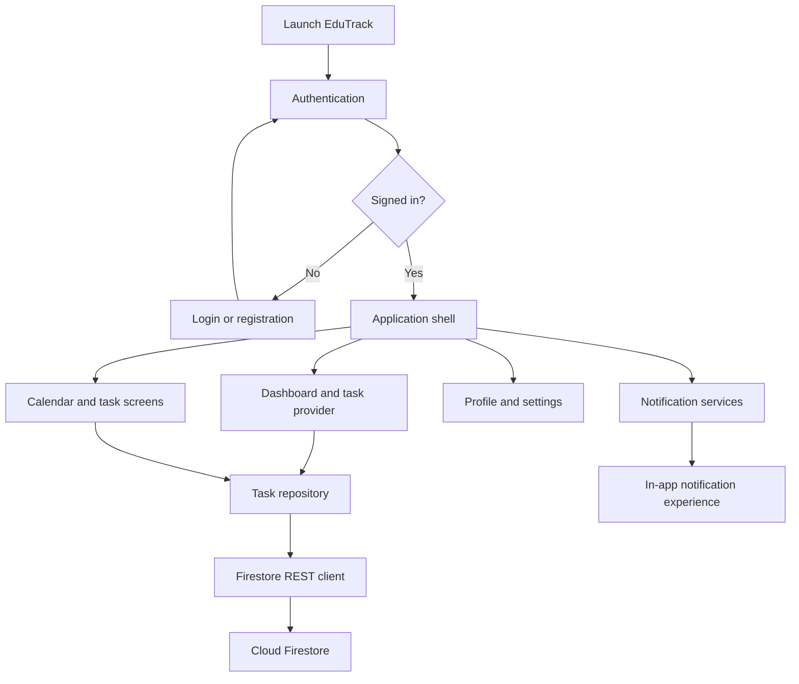

# EDUTRACK

**Smart Student Planner**

A Flutter application for organizing academic tasks, schedules, and personal study routines.

---

## Overview

EduTrack is a student-planning application built with Flutter. It brings task management, calendar views, academic summaries, profile settings, and notification experiences into a mobile-oriented interface.

The source is organized around presentation screens, state providers, repositories, and service integrations. Firebase Authentication is used for account flows, while Firestore data access is implemented through a REST client in the current source.

## Features

- Email-based registration and sign-in.
- Google sign-in integration for supported mobile platforms.
- Create, update, organize, and track academic tasks.
- Calendar views and task lookup by date.
- Dashboard summaries and task statistics.
- Task categories, priorities, statuses, and subjects.
- Profile and application settings.
- Theme, language, notification, timezone, and privacy settings screens.
- PIN-lock and security-related screens.
- In-app notification handling and Firebase Messaging integration.
- Connectivity-aware application state.

## Architecture

    Flutter UI
       │
       ▼
    Providers
       │
       ▼
    Repositories
       │
       ├── Firebase Authentication
       ├── Firestore REST client
       ├── Firebase Storage
       └── Messaging services

The source uses Provider for application state and separates data operations from screen widgets.

## Application data flow

## Technology

| Area | Technology |
| --- | --- |
| Application | Flutter / Dart |
| State management | Provider |
| Authentication | Firebase Authentication |
| Data access | Cloud Firestore REST API |
| File storage | Firebase Storage |
| Notifications | Firebase Cloud Messaging |
| Sign-in | Google Sign-In |
| Utilities | Shared Preferences, Connectivity Plus, Table Calendar |
| Tests | Flutter Test, Mocktail |

## Requirements

- Flutter SDK with Dart 3.6 or newer.
- Android Studio / Android SDK or Xcode.
- A Firebase project configured for the platforms you intend to run.
- Internet connectivity for Firebase-backed features.

## Getting started

    git clone https://github.com/gusti111/EduTrack.git
    cd EduTrack

    flutter pub get

Configure Firebase for the target platform using the official FlutterFire workflow. Review the Firebase project configuration, enabled authentication providers, Storage setup, and Firestore security rules before connecting real user data.

Run the app:

    flutter run

## Verification

Run static analysis and the test suite:

    flutter analyze
    flutter test

The repository includes tests for authentication and task repositories. Passing local tests does not, by itself, validate Firebase project rules or production credentials.

## Repository structure

    lib/
    ├── app/          # App shell, routing, and theme
    ├── core/         # Network, Firebase, errors, and shared services
    ├── models/       # Task, user, and notification models
    ├── providers/    # Application state
    ├── repositories/ # Data access
    └── screens/      # Feature screens

## Security and release notes

- Keep service-account credentials and private backend secrets out of the repository.
- Review Firestore Rules and Storage Rules independently of client-side navigation.
- Do not assume client-side role checks provide data authorization.
- Confirm that notification permissions and push delivery work on each target platform.
- Remove local IDE files, generated Flutter metadata, archives, and diagnostic logs from source control where they are not intentionally part of the project.

## Project status

An academic Flutter application with a broad feature structure and Firebase integrations. Validate each workflow against a configured Firebase project before using it with real student data.

## Author

**Gusty Faqikh** · [GitHub](https://github.com/gusti111)